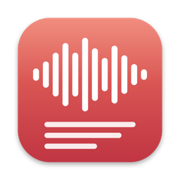
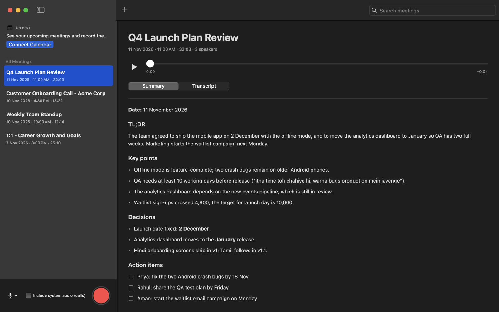

<p align="center">
  
</p>

<h1 align="center">MeetingNotes</h1>

<p align="center">
  <b>Your meetings, transcribed on your Mac.</b><br>
  A local-first alternative to Granola, built for <b>English</b> and <b>Hinglish</b>.
</p>

<p align="center">
  
  
  
  
  
</p>

<p align="center">
  <a href="https://github.com/anish5256/meetingnotes-mac/releases/latest"><b>⬇️ Download for Mac</b></a>
  &nbsp;·&nbsp; <a href="#install-in-2-minutes">Install</a>
  &nbsp;·&nbsp; <a href="#privacy">Privacy</a>
</p>

<p align="center">
  
</p>

---

You like how Granola turns a meeting into clean notes, with no bot joining the call. But you'd rather
your **audio never left your Mac**, and you need transcripts that actually understand how people talk in
India: *"Haan, launch date toh 2 December hi rakhte hain, but QA ko time chahiye."*

**MeetingNotes** records the meeting, transcribes it **locally** with Whisper on Apple Silicon, works out
**who said what**, and then your own **ChatGPT or Claude** account cleans up the transcript and writes the
summary: TL;DR, key points, decisions and action items.

## Why MeetingNotes

- 🔒 **Your audio stays on your Mac.** Transcription and speaker detection run on-device. No vendor ever hears your meeting.
- 🇮🇳 **Made for English and Hinglish.** Mixed Hindi–English speech becomes readable Roman-script Hinglish, plus an English version.
- 🎧 **Records calls, without a bot.** Google Meet, Zoom, Teams: captures your Mac's sound together with your mic, even with AirPods.
- ⚡ **Notes in about a minute.** It transcribes *while you talk*, so when you press stop only the last few seconds are left.
- 🗣️ **Knows who spoke.** You are Speaker 1; everyone else on the call gets their own label.
- 🤖 **Your AI, your account.** Pick ChatGPT or Claude (and the model) separately for transcript correction and for the summary.
- 📅 **Google Calendar aware.** See your next meeting, record it in one click, and get notes named after the meeting, with attendee names spelled right.
- 🍎 **Feels like Voice Memos.** Native SwiftUI app: library, search, player, summary and transcript tabs.
- 📂 **Plain files you own.** Every meeting is a folder of Markdown, text and audio in `~/Meetings`.

## Privacy

**MeetingNotes doesn't send your data to any external service other than your own ChatGPT or Claude account.**

- **Audio never leaves your Mac.** Recording, transcription and speaker detection all happen on-device.
- **The only thing sent anywhere is transcript text,** to the AI **you** connect (your ChatGPT or Claude account, or an
  API key/endpoint you add yourself), to correct the transcript and write the summary. You can turn correction off.
- **No third-party API vendors.** No cloud transcription service, no analytics, no tracking, and no MeetingNotes
  server or account of any kind.
- **The only other network use** is a one-time *download* of the open-source speech model (~3 GB) on first use.
  Nothing is uploaded.
- Your calendar is read locally through macOS Calendar. For a meeting you record, the attendee names go to your AI
  together with the transcript so names come out right.

## What it does

| | |
|---|---|
| 🎙️ **Record** | Any microphone (built-in, AirPods, USB), pause/resume, live transcript while you talk |
| 📞 **Calls** | "Include system audio (calls)" records the other people on Meet/Zoom/Teams alongside your mic |
| 📄 **Import** | Drop any audio file: m4a, mp3, wav, ogg/opus (WhatsApp voice notes), mp4, … |
| 📝 **Notes** | Summary with TL;DR, key points, decisions, action items and open questions |
| 🗣️ **Speakers** | Automatic speaker labels; on calls, you're always Speaker 1 |
| ✍️ **Clean transcript** | Your AI fixes misheard words while keeping how people actually spoke |
| 📅 **Calendar** | "Up next" card, one-click record, reminders at meeting start (never records on its own) |
| 🔤 **Glossary** | Teach it your names and terms once (`~/.voice-memo-glossary.txt`) |

## Install in 2 minutes

You need an **Apple Silicon Mac (M1 or newer)** with **macOS 14+** (14.2+ to record calls). 16 GB of memory is
recommended, plus about 5 GB of free disk space.

1. **[Download MeetingNotes.zip](https://github.com/anish5256/meetingnotes-mac/releases/latest)**, unzip it and drag
   **MeetingNotes** into **Applications**.
2. **Open it once.** macOS will say it can't verify the developer, because the app isn't notarized yet. Go to
   **System Settings ▸ Privacy & Security** and click **Open Anyway**. If that button doesn't appear, run this
   in Terminal and open the app again:
   ```bash
   find /Applications/MeetingNotes.app -exec xattr -d -s com.apple.quarantine {} + 2>/dev/null
   ```
3. **Connect your AI:** **Settings ▸ Accounts**. To use your ChatGPT or Claude subscription, install its free
   command-line companion once, then click **Connect** and sign in in your browser:
   ```bash
   brew install --cask codex         # ChatGPT
   brew install --cask claude-code   # Claude
   ```
   Or paste an Anthropic API key under **Settings ▸ Advanced** (nothing to install).
4. **Record!** The first recording downloads the speech model (~3 GB) once.

Everything else (Python, the transcription engine, ffmpeg, speaker models) is already inside the app.

### Permissions you'll be asked for

| When | Permission | Why |
|---|---|---|
| First recording | **Microphone** | to record you |
| First recording with *Include system audio (calls)* | **System Audio Recording** | to hear the other people on the call |
| **Connect Calendar** | **Calendars** | to show your next meeting |
| Meeting reminders | **Notifications** | "Your meeting is starting. Record?" |

### Google Calendar

MeetingNotes reads macOS Calendar. Add Google under **System Settings ▸ Internet Accounts ▸ Google** (turn on
**Calendars**), or click **Add Google Account…** in the app's calendar card. The **Up next** card shows your next
meeting with attendees in the next 12 hours.

## Using it

- **Record:** pick the mic, switch on *Include system audio (calls)* for online meetings, press the red button.
- **Record a calendar meeting:** click **Record** on the **Up next** card.
- **Existing audio:** drag files onto the window, or click **+**.
- **Pick your models:** **Settings ▸ Models**. Choose who *corrects the transcript* (or Off) and who *writes the summary*.

> Recording other people requires their consent. MeetingNotes never starts recording by itself.

Each meeting is saved to `~/Meetings/YYYY/MM/<date time> - <title>/`: `summary.md`, the transcripts, the audio and
`meta.json`. `~/Meetings/INDEX.md` lists them all.

## Troubleshooting

| Problem | Fix |
|---|---|
| The window disappeared | Click MeetingNotes in the Dock, or **Window ▸ MeetingNotes** |
| "Connect ChatGPT/Claude first" | Settings ▸ Accounts ▸ Connect (install codex / claude-code first) |
| Nothing in **Up next** | Click **Connect Calendar**, add Google in Internet Accounts; only meetings with attendees in the next 12 h show |
| Calls record only my voice | Turn on *Include system audio (calls)* before recording and allow System Audio Recording |
| A recording was interrupted | Reopen the app: unfinished recordings are completed automatically |
| A job failed | Right-click it ▸ **Show Log** |

## How it works

```
mic + call audio ──► 30 s segments ──► Whisper large-v3 (MLX, on-device) ──► speaker detection (on-device)
                                                                                    │
            ~/Meetings/<meeting>/  ◄── summary  ◄── your ChatGPT / Claude ◄── glossary + correction
```

The transcription engine lives in **[voice-memo-transcriber](https://github.com/anish5256/voice-memo-transcriber)**
and is bundled inside the app.

## Build from source

```bash
git clone https://github.com/anish5256/meetingnotes-mac.git && cd meetingnotes-mac
bash install.sh            # developer setup: engine in ~/voice-memo-transcriber + app in ~/Applications
bash scripts/package.sh    # or: self-contained app + dist/MeetingNotes.zip
```

Requires Homebrew and Xcode Command Line Tools (`xcode-select --install`). Tests: `swift test`. The app ↔ engine
contract is documented in [`docs/meeting-app-plan.md`](https://github.com/anish5256/voice-memo-transcriber/blob/main/docs/meeting-app-plan.md).

## Built with

[Whisper large-v3](https://github.com/openai/whisper) via [MLX](https://github.com/ml-explore/mlx-examples) ·
[sherpa-onnx](https://github.com/k2-fsa/sherpa-onnx) (pyannote segmentation, 3D-Speaker and NeMo TitaNet speaker models) ·
[python-build-standalone](https://github.com/astral-sh/python-build-standalone) ·
[imageio-ffmpeg](https://github.com/imageio/imageio-ffmpeg) · SwiftUI. Each keeps its own license.

## License

[MIT](LICENSE). Use it, change it, share it. Contributions welcome.
Bundled third-party components keep their own licenses (see *Built with*).

---

<p align="center">Made for meetings that switch between English and Hindi mid-sentence. ⭐ Star the repo if it helps you.</p>
